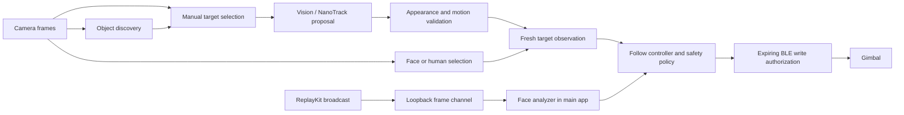

# Architecture

## Source baseline

The initial extraction uses the application's 1.1.5 source snapshot at commit `88a19b6f69723e4f02321d6cdd832c884fe05b05`. Only allowlisted tracking files and bounded host integration excerpts were exported. No original Git history was imported. [SOURCE_MANIFEST.json](SOURCE_MANIFEST.json) records original paths and both source/export digests.

Changes during extraction: generic App Group/bundle identifiers and messages; a conditional MediaPipe dependency; portable build paths; a small public Swift facade; and standalone documentation/tests. The source manifest describes the exported snapshot, not a constraint against future changes.

## Pipelines

The diagram describes the host integration. The Swift package does not acquire camera permission, start ReplayKit or write BLE by itself.

## Source map

| Component | Main files | Responsibility |
| --- | --- | --- |
| Public API | `Sources/GimbalTracking/PublicAPI.swift` | Small wrappers for face analysis, controller output and Core ML discovery |
| Cross-app control | `ScreenFollowController.swift`, `ScreenFollowModels.swift` | Confirmation, selection continuity, control shaping, freshness, framed messages |
| Cross-app image analysis | `ScreenFollowFaceAnalyzer.swift` | Vision tracking, periodic face validation, CPU fallback |
| Semantic discovery/tracking | `ObjectTrackingCoordinator.swift`, `ObjectTrackingPolicy.swift` | Detector scheduling, association, position/semantic lifetimes, revocable motion leases |
| Native physical tracking | `NativeTracking/CMNanoTrackTracker.*`, `CMNanoTrackAppearance.inc` | Fixed-template inference, candidate proposals, verified acceptance and motion evidence |
| Appearance recovery | `CMPhysicalObjectPatchTracker.*`, companion `.inc` files | Patch/features, photo reference matching and motion landmarks |
| Physical session policy | `Reference/.../CameraManager+ObjectRecognition.swift` | Photo/patch sessions, trusted evidence, recovery, part fusion, watchdogs, UI integration |
| Camera face/target | `Reference/.../CameraManager+FaceTracking.swift`, `CameraManager+Tracking.swift` | Native camera target selection, human fallback, preview conversion and command shaping |
| Frame routing | `Reference/.../CameraManager+AVCaptureDelegate.swift` | Capture callback and tracking dispatch in the original host |
| Broadcast integration | `Reference/GimbalScreenFollowBroadcast/`, `Reference/KKGimbal/CrossAppTracking/` | ReplayKit extension, main-process listener, worker and setup UI |
| Transport reference | `Reference/KKGimbal/Common/Tool/`, `Reference/KKGimbal/BLE/` | Session exclusion, pending-write invalidation, authorization and original tracking protocol |

`CameraManager.swift`, `KKBLEManager.swift` and `ProtocolParser.swift` in `Reference/` are deliberately bounded excerpts. They are not complete implementations of those host classes. Complete tracking methods and the physical-object session helpers are retained in their extension files. The host must provide camera lifecycle, queues, delegates and the BLE serializer.

## Contracts that must survive integration

1. Coordinates describe the actual input image with a lower-left origin. Preview rotation/mirroring and hardware direction are explicit transforms. Discovery expects BGRA with `.up` orientation; the native NanoTrack adapter also handles the documented bi-planar pixel buffers.
2. Motion requires current image evidence. A search proposal or a high tracker score is not sufficient permission to drive motors. Preserve the original verification/commit boundaries.
3. Use monotonic uptime for deadlines. Do not replace capture timestamps with inference-completion time or wall-clock time.
4. Keep only bounded pending work. A newer frame replaces old work; reconnecting must not replay an old motion queue.
5. Session/control IDs and leases protect the final transport write, not just the earlier decision. Stop/hold/exit must invalidate old authorization.
6. No-frame conditions require an independent host watchdog. A controller that is never called again cannot send a stop on its own.

The original camera path and screen-follow path have different tuning and coordinate/control logic. The public `FollowController` wraps the screen-follow controller; it is not a replacement for every physical-object safety policy.
