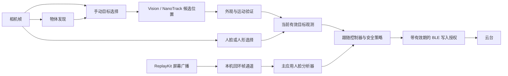

# 架构设计

**中文** · [English](ARCHITECTURE.en.md)

## 源码基线

首版提取自应用 1.1.5 的源码快照，提交为 `88a19b6f69723e4f02321d6cdd832c884fe05b05`。导出范围限定为选定的跟踪文件与宿主集成代码片段，未导入原仓库的 Git 历史。[SOURCE_MANIFEST.json](SOURCE_MANIFEST.json) 记录原始路径，以及原文件和导出文件各自的哈希摘要。

提取时的调整包括：将 App Group、Bundle 标识符和提示文案改为通用内容；将 MediaPipe 设为条件依赖；调整构建路径；添加精简的 Swift 公开接口，以及独立文档与测试。源码清单描述的是首次导出的快照，不限制后续修改。

## 处理链路

此图描述接入宿主应用后的链路。Swift Package 本身不会申请相机权限、启动 ReplayKit 或执行 BLE 写入。

## 模块与源码对应关系

| 模块 | 主要文件 | 职责 |
| --- | --- | --- |
| 公开 API | `Sources/GimbalTracking/PublicAPI.swift` | 封装人脸分析、控制器输出和 Core ML 物体发现 |
| 跨应用控制 | `ScreenFollowController.swift`、`ScreenFollowModels.swift` | 目标确认、选择连续性、控制输出整形、时效性与消息分帧 |
| 跨应用图像分析 | `ScreenFollowFaceAnalyzer.swift` | Vision 跟踪、周期性人脸校验、CPU 回退 |
| 语义发现与跟踪 | `ObjectTrackingCoordinator.swift`、`ObjectTrackingPolicy.swift` | 检测调度、目标关联、位置与语义有效期、可撤销的运动授权 |
| 原生实物跟踪 | `NativeTracking/CMNanoTrackTracker.*`、`CMNanoTrackAppearance.inc` | 固定模板推理、候选位置生成、验证后接受、运动证据 |
| 外观恢复 | `CMPhysicalObjectPatchTracker.*` 及配套 `.inc` 文件 | 图像块与特征匹配、参照照片匹配、运动特征点 |
| 实物会话策略 | `Reference/.../CameraManager+ObjectRecognition.swift` | 照片与图像块会话、可信证据、目标恢复、部件融合、看门狗、UI 集成 |
| 相机人脸与目标跟踪 | `Reference/.../CameraManager+FaceTracking.swift`、`CameraManager+Tracking.swift` | 相机目标选择、人形回退、预览坐标转换、控制输出整形 |
| 帧分发 | `Reference/.../CameraManager+AVCaptureDelegate.swift` | 原宿主中的采集回调与跟踪分发 |
| 广播集成 | `Reference/GimbalScreenFollowBroadcast/`、`Reference/KKGimbal/CrossAppTracking/` | ReplayKit 扩展、主进程监听、分析任务与设置 UI |
| 传输参考 | `Reference/KKGimbal/Common/Tool/`、`Reference/KKGimbal/BLE/` | 会话互斥、待发送指令失效、写入授权、原始跟踪协议 |

`Reference/` 中的 `CameraManager.swift`、`KKBLEManager.swift` 和 `ProtocolParser.swift` 是限定范围的代码摘录，并非完整的宿主类实现。完整的跟踪方法和实物会话辅助代码保留在对应扩展文件中。宿主需要提供相机生命周期、队列、代理与 BLE 写入串行化机制。

## 接入时必须保持的约定

1. 坐标对应实际输入图像，原点位于左下角。预览旋转、镜像和硬件方向必须显式转换。物体发现要求 BGRA 像素缓冲区与 `.up` 方向；原生 NanoTrack 适配器还支持文档所述的双平面像素缓冲区。
2. 运动必须由当前图像证据授权。搜索候选位置或较高的跟踪分数，本身不足以允许电机运动。应保留原有的验证与提交边界。
3. 有效期使用单调递增的系统运行时间。不能用推理完成时间或墙上时钟时间替代采集时间戳。
4. 待处理任务数量必须有界。新帧替换旧任务；重连后不能重放旧的运动指令队列。
5. 会话 ID、控制 ID 和授权有效期必须约束最终的传输写入，而不只是较早的决策步骤。停止、保持和退出操作都必须使旧授权失效。
6. 宿主需要独立看门狗处理断帧。若控制器不再被调用，它自身无法发出停止指令。

原相机链路与屏幕跟随链路采用不同的调参和坐标、控制逻辑。公开的 `FollowController` 封装屏幕跟随控制器，不能替代全部实物跟随安全策略。
